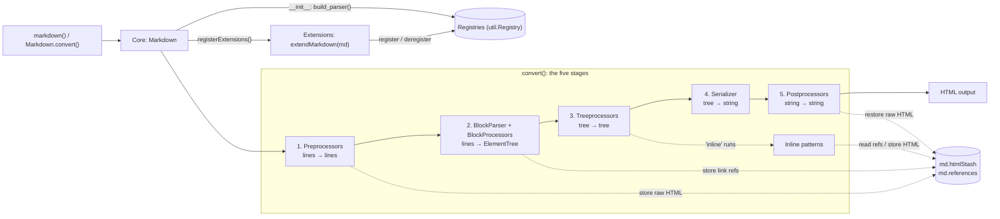

# Python-Markdown: Architecture

This document describes how the `markdown` package is put together: its main components, three key design decisions (ADRs), and the rules a developer should keep to when changing the code.

## 1. Overview

Python-Markdown turns Markdown text into (X)HTML through a fixed **five-stage pipeline** driven by the `Markdown` class. Each stage is a **priority-ordered registry of processors**. All behaviour, built-in or added, comes from the processors in those registries. **Extensions** change the converter by registering, replacing or removing processors; they never change the pipeline itself. The package has no runtime third-party dependencies (`pyproject.toml` declares none).

### Components

| # | Component | Files | Responsibility |
|---|-----------|-------|----------------|
| 1 | **Core** | `core.py`, `__init__.py`, `__main__.py` | Public API (`markdown()`, `markdownFromFile()`, `Markdown`, `convert()`, `convertFile()`, the `markdown_py` CLI). `build_parser()` creates the five registries; `registerExtensions()`/`build_extension()` load extensions. Holds shared per-instance state: `htmlStash`, `references`, `ESCAPED_CHARS`, `block_level_elements`, `output_format`/`serializer`. `reset()` clears the per-document state. |
| 2 | **Preprocessors** | `preprocessors.py`, `htmlparser.py` | Work on the source as a list of lines before parsing. Defaults: `normalize_whitespace` (30) and `html_block` (20). The latter uses `HTMLExtractor` (`htmlparser.py`) to move raw HTML blocks into the `htmlStash`. |
| 3 | **Block parser** | `blockparser.py`, `blockprocessors.py` | `BlockParser.parseDocument()` creates the root element (`md.doc_tag`, a `div`), splits the text into blocks on blank lines, and for each block asks every `BlockProcessor` in priority order whether it applies (`test()`), then calls `run()`. Processors build `ElementTree` elements and may recurse through `parser.parseChunk()`/`parseBlocks()`. A `State` stack (`parser.state`) tracks nesting such as lists. Defaults: `empty` 100, `indent` 90, `code` 80, `hashheader` 70, `setextheader` 60, `hr` 50, `olist` 40, `ulist` 30, `quote` 20, `reference` 15, `paragraph` 10. |
| 4 | **Tree processors** | `treeprocessors.py` | Work on the whole `ElementTree` after block parsing. Defaults: `inline` 20 (runs the inline patterns), `prettify` 10 (adds whitespace and newlines), `unescape` 0 (turns backslash-escape placeholders back into characters). |
| 5 | **Inline patterns** | `inlinepatterns.py` | Regex-based `InlineProcessor` subclasses whose `handleMatch(m, data)` returns `(element_or_text, start, end)`. The `inline` tree processor applies them to each element's text in priority order. Defaults: `backtick` 190, `escape` 180, `reference` 170, `link` 160, `image_link` 150, `image_reference` 140, `short_reference` 130, `short_image_ref` 125, `autolink` 120, `automail` 110, `linebreak` 100, `html` 90, `entity` 80, `em_strong` 60 (a `DelimiterProcessor` for `*` and `_`). |
| 6 | **Serializers and postprocessors** | `serializers.py`, `postprocessors.py` | The serializer (`to_xhtml_string` by default, or `to_html_string`) turns the tree into a string and escapes text and attributes. Postprocessors then work on that string: `raw_html` 30 (replaces stash placeholders with the stored HTML) and `amp_substitute` 20. |
| 7 | **Utilities** | `util.py` | Shared building blocks: `Registry`, the `Processor` base class, `AtomicString`, `HtmlStash`, placeholder templates (`STX`/`ETX`-delimited), `BLOCK_LEVEL_ELEMENTS`, and the entry-point lookup `get_installed_extensions()`. |
| 8 | **Extensions** | `extensions/__init__.py`, `extensions/*.py` | The `Extension` base class (config handling plus `extendMarkdown(md)`) and 18 built-in extensions (e.g. `tables`, `footnotes`, `def_list`, `fenced_code`, `codehilite`, `admonition`, `smarty`, `meta`). `extra` is a bundle that loads several others. |

### How the components call each other

Processors reach shared state through the `Markdown` instance. Block processors use `self.parser.md`. Other processors receive it as the optional `md` constructor argument (`self.md`). Built-ins that need no shared state are created without it (e.g. `backtick`, `linebreak`, `amp_substitute`), so a processor that uses `self.md` must be constructed with `md`. Dependencies point one way: `util.py` imports no other module of the package at runtime (only a type-checking import of `Markdown`); the core stage modules depend on `util.py`; extensions depend on the core modules; the core never imports a specific extension.

## 2. Architecture Decision Records

### ADR-1: A priority-sorted `Registry` for every processing stage

**Status:** Verified. Commit `6ee07d2` (2018), *"Replace homegrown OrderedDict with purpose-built Registry. (#688)"*, which fixes issue #418. The deprecated compatibility shim was removed in commit `a767b2d` (2022, *"Remove previously deprecated objects"*). Implementation: `markdown/util.py`, class `Registry`.

**Context.** Processors used to live in a home-grown `OrderedDict` where each item was placed relative to another by a location string (`"_begin"`, `"<name"`, `">name"`). Placement depended on which other items happened to be present and on the order extensions were loaded, which made combining extensions fragile.

**Decision.** Every stage (`preprocessors`, `parser.blockprocessors`, `inlinePatterns`, `treeprocessors`, `postprocessors`) is a `util.Registry`. Items are registered with a **name** and a numeric **priority** and are iterated from highest to lowest priority. Items with equal priority keep their registration order. Registering an existing name replaces the old item, which is then sorted by its new priority. `deregister(name)` removes an item. Items can be looked up by name or index.

**Alternatives considered.** (a) Keep the relative-location `OrderedDict` API. It was kept only as a deprecated shim and later removed. (b) Use plain lists that extensions insert into by index, which has the same load-order fragility.

**Consequences.** Placement is independent of load order, and any built-in processor can be replaced or removed by name. On the other hand, priorities act as global "magic numbers": to place a new processor correctly, an author must know the priorities of the built-ins it has to run before or after (listed in §1).

### ADR-2: Extensions are found by entry point, with a dotted-path fallback

**Status:** Verified. Commit `cd73243` (2018), *"Refactor Extension loading (#627)"*. Implementation: `Markdown.build_extension()` in `markdown/core.py` and `util.get_installed_extensions()` in `markdown/util.py`; built-in names are declared in `pyproject.toml`.

**Context.** Short names such as `'tables'` used to be special-cased to modules inside `markdown.extensions`, and there was also an `mdx_` module-prefix convention. Third-party authors who wanted short names told users to copy files into the package.

**Decision.** A string name passed in `extensions=[...]` is first looked up in the `markdown.extensions` **entry-point group** of the installed distributions. If no entry point matches, the string is treated as a dotted import path `package.module[:ClassName]`. Without a class name, the module's `makeExtension(**kwargs)` is called. Extension *instances* may also be passed directly. All built-ins are declared under `[project.entry-points.'markdown.extensions']` in `pyproject.toml`.

**Alternatives considered.** (a) Keep special-casing the `markdown.extensions` package and the `mdx_` prefix (removed in this change). (b) Require full dotted paths for everything, which would break existing short names.

**Consequences.** Third-party extensions get short names on the same terms as built-ins, and dotted paths still work without packaging. On the other hand, a short name exists only in **installed** package metadata: a new or renamed entry point takes effect only after the distribution is (re)installed, and until then the string is treated as a module path.

### ADR-3: `ElementTree` as the document model; raw HTML and protected text kept out of reach

**Status:** Inferred. The switch is recorded (commit `a218ebb`, 2008, *"ElementTree support added"*, which replaced the earlier home-grown `NanoDom`), `serializers.py` says it was *"taken from ElementTree 1.3 preview"*, and the `HtmlStash` docstring describes the stash. No commit or issue states the *reasons*, so the rationale below is our own reading of the code.

**Context.** A Markdown document mixes structure (paragraphs, lists, emphasis) with raw HTML that must pass through untouched. A pipeline of string substitutions (the original `Markdown.pl` approach) gives later steps no view of the structure and can easily process the same text twice.

**Decision.** Block parsing builds an `xml.etree.ElementTree`. Later stages work on elements, and the package's own serializers produce HTML or XHTML. Content that must not be treated as Markdown is kept out of reach in two ways. (1) **Raw HTML** is not put into the tree: it is stored in `md.htmlStash` and replaced by a placeholder (`STX + "wzxhzdk:N" + ETX`), which the `raw_html` postprocessor swaps back after serialization. (2) **Text that must not be processed by further inline patterns** is wrapped in `util.AtomicString`, which the `inline` tree processor skips. Backslash escapes follow the same idea: the `escape` pattern replaces an escaped character with an `STX`/`ETX` placeholder, and the `unescape` tree processor restores it at the end.

**Alternatives considered.** (a) A string-only pipeline. (b) The earlier custom DOM (`NanoDom`). (c) Parsing raw HTML into the tree, which would need a full HTML parser and would normalise or re-escape the user's HTML.

**Consequences.** Extensions can inspect and rewrite structure with tree processors, and output escaping happens in one place, the serializer. On the other hand, content travels on two channels, the tree and the stash, and developers must use the right one. Text placed in an element is escaped on output, so markup must be stored in the stash or built as elements. Placeholders also appear as ordinary text inside the tree, so tree processors see placeholders rather than the HTML behind them.

## 3. Constraints

| # | Rule | Where it is visible |
|---|------|---------------------|
| C1 | **Change the pipeline only through the Registry API.** Add, replace or remove processors with `register(item, name, priority)` / `deregister(name)` on the instance's registries (`md.preprocessors`, `md.parser.blockprocessors`, `md.inlinePatterns`, `md.treeprocessors`, `md.postprocessors`). Do not edit the default `build_*` functions to add optional behaviour, and choose priorities relative to the built-ins. | `markdown/util.py` (`Registry`); `markdown/core.py` (`build_parser`); defaults in the `build_*` functions of each stage module |
| C2 | **Extensions follow the extension contract.** Subclass `markdown.extensions.Extension`, declare options as `self.config = {name: [default, description]}` before calling `super().__init__(**kwargs)`, read them with `getConfig`/`getConfigs`, do all wiring in `extendMarkdown(md)`, and provide a module-level `makeExtension(**kwargs)`. Built-ins live in `markdown/extensions/` and are listed as entry points in `pyproject.toml`. | `markdown/extensions/__init__.py`; `pyproject.toml` (`[project.entry-points.'markdown.extensions']`); any built-in such as `markdown/extensions/admonition.py` |
| C3 | **Dependencies point one way.** Core modules (`core.py`, `blockparser.py`, `blockprocessors.py`, `inlinepatterns.py`, `treeprocessors.py`, `preprocessors.py`, `postprocessors.py`, `serializers.py`, `util.py`) must not import any specific extension module. The only extension imports in the core are of the `Extension` base class (in `core.py` and the package `__init__.py`). Extensions may import core modules. | Import blocks of `markdown/core.py` and `markdown/__init__.py`; imports of the other core modules |
| C4 | **Use the right channel for protected content.** Raw HTML that must reach the output unchanged goes through `md.htmlStash.store()`. Text that later inline patterns must not touch is an `util.AtomicString`. Never put pre-rendered HTML into element text or attributes: the serializer will escape it. | `markdown/util.py` (`AtomicString`, `HtmlStash`); `markdown/treeprocessors.py` (`InlineProcessor` skips `AtomicString`); `markdown/postprocessors.py` (`RawHtmlPostprocessor`) |
| C5 | **Per-document state must be resettable.** One `Markdown` instance may convert many documents. State that belongs to one document lives on the instance (e.g. `htmlStash`, `references`) or on an extension. An extension with such state calls `md.registerExtension(self)` and implements `reset()`, which `Markdown.reset()` calls. | `markdown/core.py` (`registerExtension`, `reset`) |
